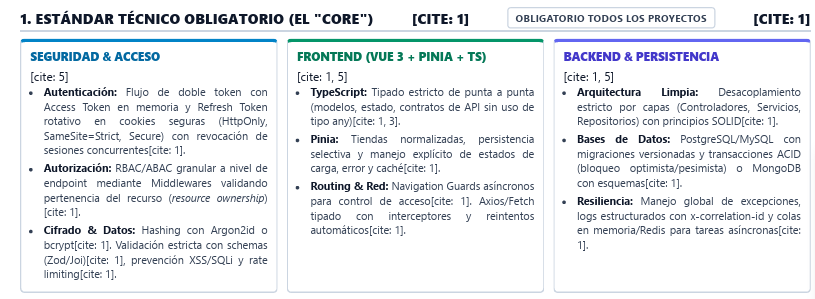

# 02 · Estándar técnico obligatorio ("CORE")

Es obligatorio para todos los proyectos. Fuente: [assets/estandar-core.png](assets/estandar-core.png).

## Requisitos (transcripción)

### Seguridad y acceso

- **S1 · Autenticación.** Flujo de doble token: Access Token en memoria y Refresh Token rotativo en cookie segura (HttpOnly, SameSite=Strict, Secure), con revocación de sesiones concurrentes.
- **S2 · Autorización.** RBAC/ABAC granular a nivel de endpoint mediante middlewares que validen que el recurso pertenece a quien lo pide (*resource ownership*).
- **S3 · Cifrado y datos.** Hashing con Argon2id o bcrypt. Validación estricta con schemas (Zod/Joi), prevención de XSS y SQLi, y rate limiting.

### Frontend (Vue 3 + Pinia + TS)

- **F1 · TypeScript.** Tipado estricto de punta a punta (modelos, estado y contratos de API), sin `any`.
- **F2 · Pinia.** Stores normalizados, persistencia selectiva y manejo explícito de los estados de carga, error y caché.
- **F3 · Routing y red.** Navigation Guards asíncronos para el control de acceso. Axios/Fetch tipado con interceptores y reintentos automáticos.

### Backend y persistencia

- **B1 · Arquitectura limpia.** Desacoplamiento estricto por capas (controladores, servicios y repositorios) con principios SOLID.
- **B2 · Bases de datos.** PostgreSQL/MySQL con migraciones versionadas y transacciones ACID (bloqueo optimista o pesimista), o MongoDB con esquemas.
- **B3 · Resiliencia.** Manejo global de excepciones, logs estructurados con `x-correlation-id` y colas en memoria o Redis para las tareas asíncronas.

## Matriz de cumplimiento

Estado: ✔ hecho · ▶ en curso · ☐ pendiente. Cada fila debe terminar con una prueba automática que la demuestre.

| Req. | Cómo se cumple en el SIEM | Dónde | Prueba | Sprint | Estado |
| --- | --- | --- | --- | --- | --- |
| S1 | Access JWT de 10 min guardado solo en memoria (store `auth`). Refresh opaco de 7 días en cookie `HttpOnly; Secure; SameSite=Strict; Path=/api/v1/auth`, guardado como hash, que rota en cada uso. Reutilizar un refresh revoca toda la familia. Máximo 3 sesiones por usuario y `logout-all` | `api/modules/auth` | e2e `auth.e2e-spec.ts`: rotación, reutilización, límite de sesiones | S4 | ☐ |
| S2 | `RolesGuard` (RBAC) con `@Roles()` en cada endpoint. `PolicyGuard` (ABAC) con `@CheckPolicy()`: solo el analista asignado o un admin cambia una alerta. Los agentes se autentican con `AgentKeyGuard` | `api/common/guards` | e2e: auditor recibe 403; un analista no asignado recibe 403 | S4 | ☐ |
| S3 | Argon2id para contraseñas y llaves de agente. Zod en todas las entradas (body, query, params, env, YAML). Solo consultas parametrizadas de TypeORM. `helmet` con CSP, `v-html` prohibido. `@nestjs/throttler` con almacén en Redis | `api/common`, `packages/shared` | e2e: un payload inválido da 400; ráfaga de logins da 429; `raw` con `<script>` se muestra escapado | S3–S4 | ▶ |
| F1 | `strict: true`, `noImplicitAny` y la regla ESLint `no-explicit-any: error`. Los tipos del contrato salen de los schemas Zod de `packages/shared` (`z.infer`), compartidos con la API | `apps/web`, `packages/shared` | `pnpm -r typecheck` y `pnpm -r lint` en verde | S3–S5 | ▶ |
| F2 | Stores `events` y `alerts` normalizados (`byId`, `allIds`), con `status` (`idle`, `loading`, `success`, `error`), `error` y `fetchedAt` (caché con TTL). Persistencia selectiva: solo los filtros y preferencias de UI se guardan en `localStorage`; nunca los tokens | `apps/web/src/stores` | Vitest de los stores | S5 | ☐ |
| F3 | `router.beforeEach` asíncrono que restaura la sesión con `/auth/refresh` y valida `meta.roles`. Instancia Axios tipada: un interceptor añade el Bearer y, ante un 401, hace un único refresh en cola y reintenta; reintentos con backoff para errores de red/5xx en métodos idempotentes | `apps/web/src/router`, `apps/web/src/api/http.ts` | Vitest del interceptor (401 → refresh → reintento) | S5 | ☐ |
| B1 | Módulos NestJS con capa `controller` (HTTP), `service` (casos de uso) y `repository` (acceso a datos tras una interfaz). El motor de reglas es una función pura sin dependencias de infraestructura | `apps/api/src/modules/*` | Pruebas unitarias de servicios con repositorios falsos | S3 | ▶ |
| B2 | PostgreSQL 16 con migraciones de TypeORM versionadas en Git (`synchronize: false`). La ingesta guarda evento y eslabón en la misma transacción, con **bloqueo pesimista** (`FOR UPDATE`) del último eslabón. Las alertas usan **bloqueo optimista** (`@VersionColumn`) y un conflicto responde 409 | `apps/api/src/database`, `modules/forensics`, `modules/alerts` | e2e: 20 ingestas concurrentes dejan una cadena lineal y válida; un PATCH con versión vieja da 409 | S3–S6 | ▶ |
| B3 | `AllExceptionsFilter` que responde en formato `application/problem+json` (RFC 7807). `nestjs-pino` escribe logs JSON con `correlationId`. El middleware lee o genera `x-correlation-id` y lo devuelve en la respuesta. La cola BullMQ `deteccion` recibe ese correlationId | `apps/api/src/common`, `modules/detection` | e2e: toda respuesta trae `x-correlation-id` y los errores tienen forma problem+json | S3 | ▶ |

> **Nota sobre Zod/Joi:** se usa Zod en el backend y en el frontend con los mismos schemas (`packages/shared`). Así el contrato de la API está tipado de punta a punta (F1) y la validación es una sola fuente de verdad (S3).
