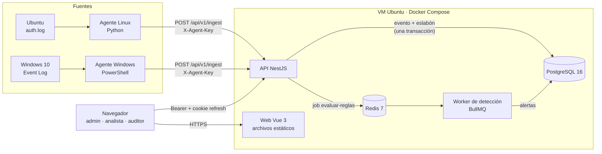
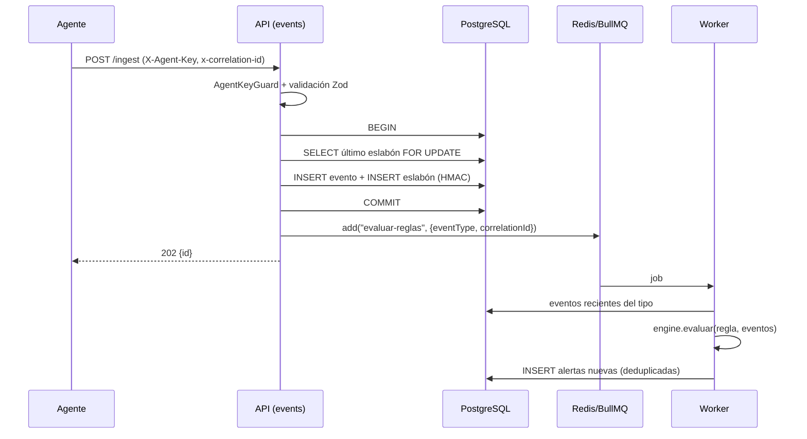
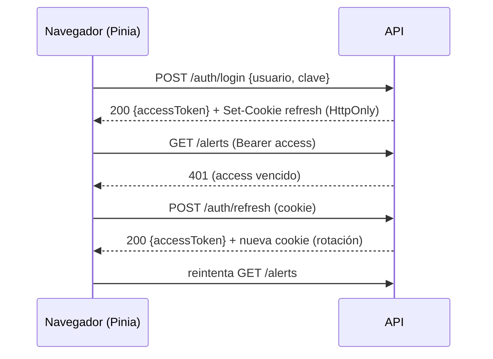

# 03 · Arquitectura

## Componentes

| Componente | Tecnología | Responsabilidad |
| --- | --- | --- |
| Agente Linux | Python 3 (`agents/linux`) | Sigue `/var/log/auth.log`, parsea y envía. Tolera líneas dañadas |
| Agente Windows | PowerShell (`agents/windows`) | Lee los eventos 4624, 4625 y 4720 y los envía |
| API | NestJS + TypeScript (`apps/api`) | Ingesta, autenticación, alertas, forense, línea de tiempo y OpenAPI |
| Worker | El mismo código de la API con otro proceso de arranque (`main.worker.ts`) | Consume la cola `deteccion` y evalúa las reglas |
| Web | Vue 3 + Vite + Pinia (`apps/web`) | Interfaz para analistas y auditores |
| PostgreSQL 16 | Docker | Único almacén: eventos, cadena, alertas, usuarios y sesiones |
| Redis 7 | Docker | Cola BullMQ y contadores del rate limiting |
| Contrato | Zod (`packages/shared`) | Schemas y tipos compartidos entre API y web |

## Flujo de ingesta y detección

- Si el `event_id` ya existe, la transacción se revierte y la respuesta es **409** (el agente puede reenviar sin duplicar).
- Si Redis no está disponible, el evento **igual queda guardado y sellado**. Al arrancar, el worker reevalúa la ventana reciente, así que la detección se retrasa pero no se pierde.

## Flujo de autenticación (resumen)

Ver el detalle en [04-seguridad.md](04-seguridad.md).

## Despliegue

Todo corre en la VM Ubuntu (192.168.56.101) con `docker compose`: `postgres`, `redis`, `api`, `worker` y `web` (nginx con los estáticos de Vite, que hace de proxy de `/api` a la API). En desarrollo, la API y la web pueden correr en el PC contra el Postgres y el Redis de la VM.

| Puerto | Servicio | Expuesto a |
| --- | --- | --- |
| 80 | web (nginx) → `/api` proxy a 3000 | red solo-anfitrión |
| 3000 | API | solo dentro de Docker (y localhost en desarrollo) |
| 5432 | PostgreSQL | red solo-anfitrión (DBeaver) |
| 6379 | Redis | solo 127.0.0.1 |

## Principios

- **Un solo almacén de verdad** (PostgreSQL). Redis solo tiene datos efímeros (la cola y los contadores).
- **Guardar y sellar son una sola operación atómica.** No puede existir un evento sin su eslabón.
- **La detección es asíncrona** y no frena la ingesta.
- **El motor es puro:** recibe una regla y una lista de eventos y devuelve alertas. Se prueba sin base de datos.
