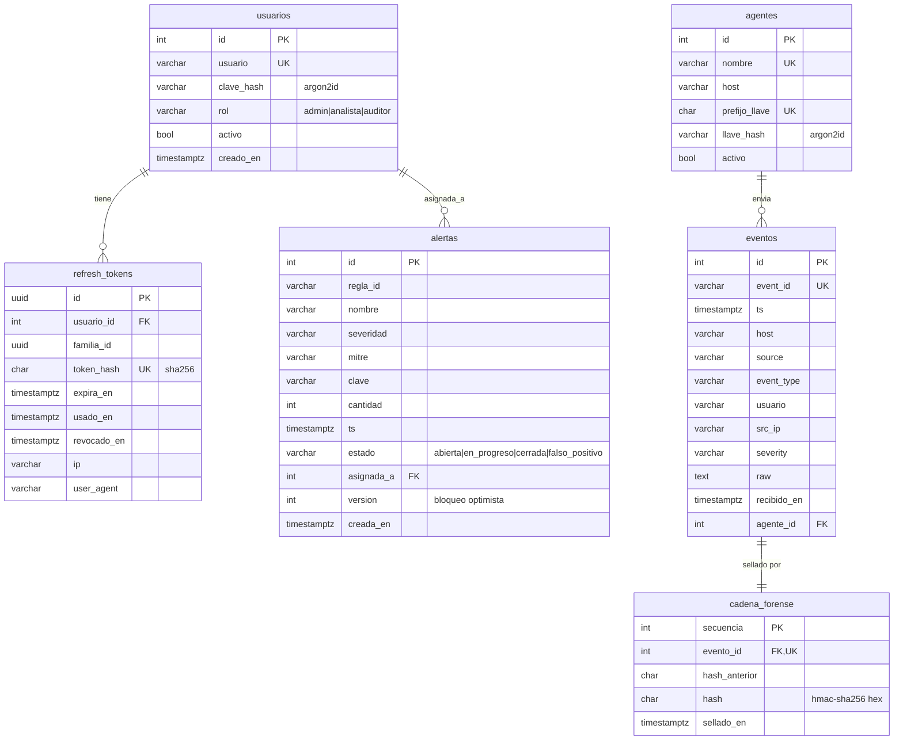

# 07 · Datos y persistencia

Cubre B2 del [estándar CORE](02-estandar-core.md).

## Modelo

- Las tablas `eventos` y `alertas` **conservan los nombres y columnas** del modelo SQLAlchemy anterior (`app/db.py`), así los datos del laboratorio no se pierden. La migración inicial hace `CREATE TABLE IF NOT EXISTS` y luego añade las columnas nuevas.
- Índices: `eventos(event_type, ts)`, `eventos(src_ip, ts)`, `eventos(usuario, ts)`, `eventos(host, ts)` y `alertas(regla_id, clave, ts)`, este último único (ya existe).

## Migraciones versionadas

- TypeORM con `synchronize: false` siempre. Cada cambio de esquema es una migración en `apps/api/src/database/migrations/`, con nombre `<timestamp>-<Descripcion>.ts`, versionada en Git e irreversible solo si se justifica.
- Comandos: `pnpm --filter api migration:generate <Nombre>`, `migration:run` y `migration:revert`.
- Plan inicial:
  1. `0001-EsquemaBase`: `eventos` y `alertas` (compatibles con lo existente).
  2. `0002-Seguridad`: `usuarios`, `refresh_tokens` y `agentes`; `eventos.agente_id`.
  3. `0003-CadenaForense`: `cadena_forense` y el eslabón génesis.
  4. `0004-FlujoAlertas`: `alertas.estado`, `asignada_a` y `version`.

## Transacciones y bloqueos

| Operación | Riesgo | Estrategia |
| --- | --- | --- |
| Ingesta de un evento | Dos ingestas concurrentes leen el mismo "último eslabón" y la cadena se **bifurca** | **Pesimista:** en una sola transacción, `SELECT ... FROM cadena_forense ORDER BY secuencia DESC LIMIT 1 FOR UPDATE`, después `INSERT evento`, calcular el HMAC e `INSERT eslabón`, y al final `COMMIT`. Serializa solo la escritura de la cadena, que es rápida |
| Cambio de estado o asignación de una alerta | Dos analistas editan a la vez y uno **pisa** al otro | **Optimista:** `@VersionColumn`. El cliente envía la `version` que vio; si no coincide, se responde 409 y la UI recarga |
| Rotación de refresh | Dos pestañas refrescan a la vez | `UPDATE refresh_tokens SET usado_en = now() WHERE id = $1 AND usado_en IS NULL` y comprobar las filas afectadas. Una gana; la otra recibe 401 sin revocar la familia si llega dentro de una gracia de 10 s |
| Creación de alertas | El worker reintenta y duplica | Constraint única `(regla_id, clave, ts)` más la comprobación de ventana del servicio |

Las transacciones se manejan con `DataSource.transaction(async (em) => ...)` dentro del servicio. Los repositorios aceptan un `EntityManager` opcional para participar en ella.

## Retención

Los eventos y la cadena **no se borran ni se actualizan** desde la aplicación: la tabla es de solo inserción. Se aplica `REVOKE UPDATE, DELETE ON eventos, cadena_forense FROM siem_app` al usuario de la aplicación, y las migraciones corren con un usuario aparte (`siem_owner`).
