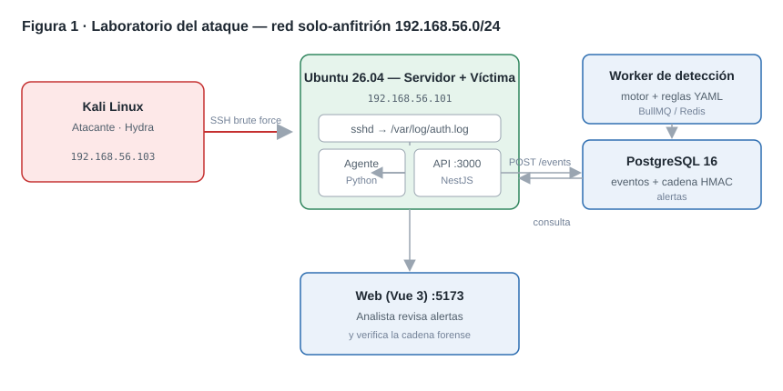
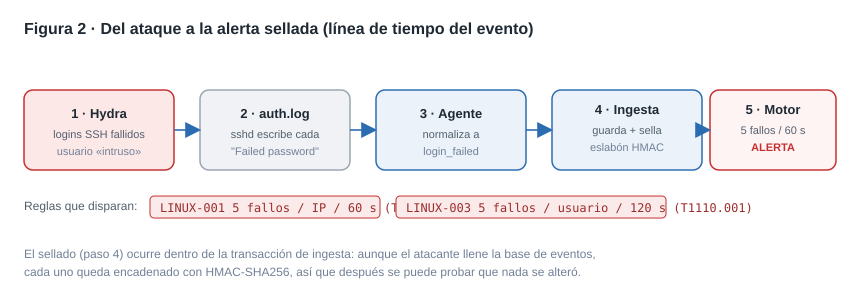
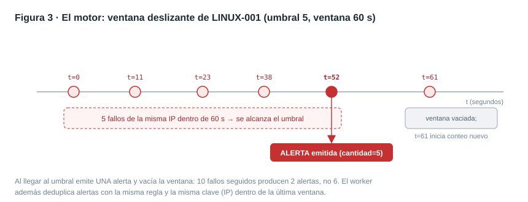
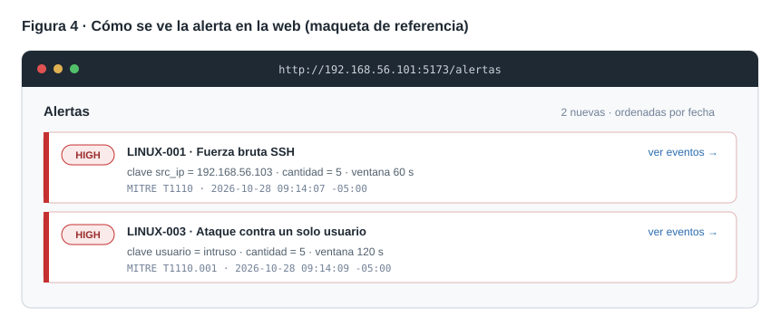
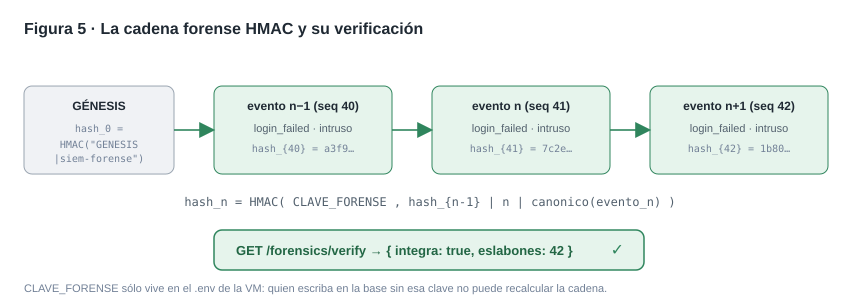
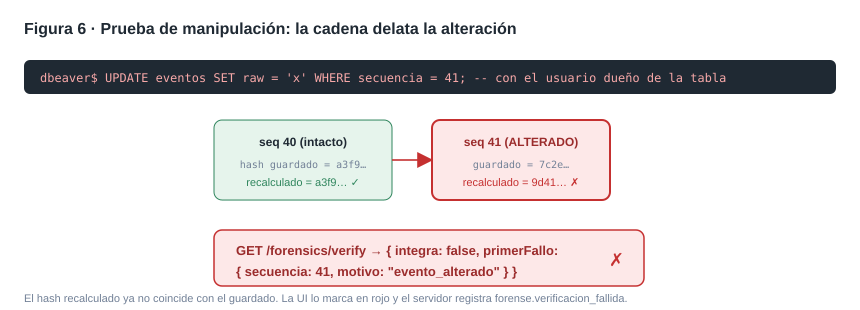

# 13 · Demostración de ataque: fuerza bruta SSH detectada por el SIEM

Esta guía reproduce, de principio a fin, un ataque de **fuerza bruta SSH** contra el servidor
Ubuntu del laboratorio y muestra cómo el SIEM lo detecta (reglas `LINUX-001` y `LINUX-003`,
MITRE **T1110**) y cómo la **cadena forense HMAC** prueba que la evidencia no fue alterada.

> **Alcance y ética.** Todo ocurre dentro de la red solo-anfitrión `192.168.56.0/24` del
> laboratorio ([11-laboratorio.md](11-laboratorio.md)), contra máquinas propias. No se ataca
> ningún sistema de terceros. Restaurar el snapshot `dia5-limpio` al terminar.

Cada paso trae una figura de referencia. Donde dice **📸 Captura**, haz tú la captura real de
pantalla de tu VM y colócala debajo, para que el entregable tenga la evidencia de tu propio laboratorio.

---

## 0 · Topología y preparación



| Máquina | Rol | IP |
| --- | --- | --- |
| Kali | Atacante (Hydra) | `192.168.56.103` |
| Ubuntu | Servidor del SIEM + víctima SSH | `192.168.56.101` |
| PC (Windows 11) | Analista: navegador y DBeaver | `192.168.56.1` |

**En Ubuntu**, dejar todo el stack encendido (ver [11-laboratorio.md](11-laboratorio.md#cómo-encender-todo)):

```bash
cd ~/siem-forense
docker compose up -d postgres redis
pnpm --filter api migration:run
pnpm --filter api start          # API en :3000
pnpm --filter api start:worker   # worker de detección (otra terminal)
pnpm --filter web dev --host     # web en :5173 (otra terminal)
# Agente que vigila /var/log/auth.log:
cd agents/linux && sudo SIEM_AGENT_KEY=<llave-del-agente> .venv/bin/python agent_linux.py
```

Comprobar que la API responde antes de atacar:

```bash
curl -s http://192.168.56.101:3000/api/v1/health
# {"estado":"ok","db":"ok","redis":"ok"}
```

> **📸 Captura 0:** salida de `/health` y las cuatro terminales (API, worker, web, agente) corriendo.

---

## 1 · Estado inicial (línea base)

Antes del ataque, deja constancia de que **no hay alertas** de fuerza bruta. En la web
(`http://192.168.56.101:5173`) inicia sesión como analista y abre **Alertas**; o por API:

```bash
# Obtener un accessToken (usuario analista del laboratorio)
TOKEN=$(curl -s http://192.168.56.101:3000/api/v1/auth/login \
  -H 'Content-Type: application/json' \
  -d '{"usuario":"analista","clave":"<clave>"}' | jq -r .accessToken)

curl -s "http://192.168.56.101:3000/api/v1/alerts?regla_id=LINUX-001&tamano=5" \
  -H "Authorization: Bearer $TOKEN" | jq '.total'
# 0
```

> **📸 Captura 1:** la vista **Alertas** vacía (o `total: 0`). Es tu "antes".

---

## 2 · Lanzar el ataque desde Kali



En la terminal de **Kali**, lanzar Hydra contra el SSH de Ubuntu. Se usa un único usuario
(`intruso`) para que disparen a la vez `LINUX-001` (por IP) y `LINUX-003` (por usuario):

```bash
hydra -l intruso -P /usr/share/wordlists/rockyou.txt -t 4 -f ssh://192.168.56.101
```

- `-l intruso` — usuario objetivo (uno solo, a propósito).
- `-P rockyou.txt` — diccionario de contraseñas.
- `-t 4` — 4 intentos en paralelo (suficiente para pasar el umbral en segundos).
- `-f` — se detiene al primer acierto (en el laboratorio no habrá acierto: el usuario no existe,
  y eso basta: lo que el SIEM detecta son los **fallos**).

Cada intento fallido deja en Ubuntu una línea `Failed password for ... from 192.168.56.103` en
`/var/log/auth.log`. Puedes verlas en vivo en Ubuntu:

```bash
sudo grep -a 'Failed password' /var/log/auth.log | tail -n 10
```

> **📸 Captura 2:** la salida de Hydra en Kali **y** el `tail` de `auth.log` en Ubuntu, lado a lado.

---

## 3 · El agente envía los eventos

El agente Linux lee las líneas nuevas de `auth.log`, las normaliza a eventos `login_failed`
(con `src_ip = 192.168.56.103`, `usuario = intruso`) y los envía a `POST /api/v1/ingest` con su
`X-Agent-Key`. La API responde `202 { id, secuencia }` y **sella cada evento en la cadena HMAC**
dentro de la misma transacción de ingesta.

En la terminal del agente se ven las respuestas `202`. Para confirmar que llegaron, por API:

```bash
curl -s "http://192.168.56.101:3000/api/v1/events?src_ip=192.168.56.103&event_type=login_failed&tamano=5" \
  -H "Authorization: Bearer $TOKEN" | jq '.total'
```

> **📸 Captura 3:** la terminal del agente con las respuestas `202` (y algún `409` si reenvía algo ya visto; el `event_id` es la huella de la línea, así que reenviar no duplica).

---

## 4 · El motor evalúa y dispara la alerta



El worker, por cada regla del tipo `login_failed`, lee los eventos recientes, los agrupa por la
clave de la regla y desliza una ventana. En cuanto hay **5 fallos de la misma IP en 60 s**, emite
una alerta y vacía la ventana (10 fallos → 2 alertas, no 6). El worker además deduplica alertas de
la misma regla y clave dentro de la ventana.

Resultado esperado en menos de un minuto:

| Regla | Agrupa por | Umbral / ventana | Severidad | MITRE |
| --- | --- | --- | --- | --- |
| `LINUX-001` Fuerza bruta SSH | `src_ip` = 192.168.56.103 | 5 / 60 s | high | T1110 |
| `LINUX-003` Ataque a un usuario | `usuario` = intruso | 5 / 120 s | high | T1110.001 |

---

## 5 · La alerta en la consola del analista



Refresca la vista **Alertas** en la web: aparecen las dos alertas `high`, con la clave
(`192.168.56.103` / `intruso`), la cantidad y la etiqueta MITRE. Al abrir una alerta se ven los
eventos que la provocaron (`GET /alerts/:id`). Por API:

```bash
curl -s "http://192.168.56.101:3000/api/v1/alerts?regla_id=LINUX-001&tamano=5" \
  -H "Authorization: Bearer $TOKEN" | jq '.items[0]'
```

> **📸 Captura 4:** la vista **Alertas** con las dos tarjetas `high`. Es tu "después" (compáralo con la Captura 1).

---

## 6 · La cadena forense prueba que la evidencia es íntegra



Cada evento quedó sellado con `hash_n = HMAC-SHA256(CLAVE_FORENSE, hash_{n-1} | n | canonico(evento_n))`.
Para demostrar que **nada se alteró**, un usuario `admin` o `auditor` ejecuta la verificación:

```bash
# Token de un usuario con rol admin o auditor
curl -s http://192.168.56.101:3000/api/v1/forensics/verify \
  -H "Authorization: Bearer $TOKEN_AUDITOR" | jq
# { "integra": true, "eslabones": 42 }
```

En la web, el botón **Verificar cadena** lo muestra en verde con el número de eslabones.

> **📸 Captura 5:** respuesta `integra: true` (API) o el indicador verde en la web.

---

## 7 · (Opcional) Demostrar que la cadena detecta manipulación



Para mostrar el valor forense, altera un evento **saltándote la aplicación** (en DBeaver, con el
usuario dueño de la tabla; el usuario de la aplicación no puede hacer `UPDATE`):

```sql
UPDATE eventos SET raw = 'x' WHERE secuencia = 41;   -- elige una secuencia del ataque
```

Vuelve a verificar: el hash recalculado del evento 41 ya no coincide con el guardado, así que la
cadena se rompe **en el primer fallo**:

```bash
curl -s http://192.168.56.101:3000/api/v1/forensics/verify \
  -H "Authorization: Bearer $TOKEN_AUDITOR" | jq
# { "integra": false, "primerFallo": { "secuencia": 41, "eventoId": "...", "motivo": "evento_alterado" } }
```

Como el sello usa HMAC con `CLAVE_FORENSE` (que vive solo en el `.env` de la VM, nunca en la base),
quien tenga acceso de escritura a la base pero no a la clave **no puede recalcular** la cadena para
disimular el cambio. La UI lo marca en rojo y el servidor registra `forense.verificacion_fallida`.

| Situación | `motivo` informado |
| --- | --- |
| Hash recalculado ≠ guardado | `evento_alterado` |
| `hash_anterior` ≠ hash del eslabón previo | `cadena_rota` |
| Hueco en la secuencia | `eslabon_faltante` |
| Evento sin eslabón | `evento_sin_sellar` |

> **📸 Captura 6:** respuesta `integra: false` con `evento_alterado` (o el indicador rojo en la web).
>
> **Restaurar:** al terminar, vuelve al snapshot `dia5-limpio` para dejar la cadena sana.

---

## Resumen de la demostración

1. **Antes:** 0 alertas (Captura 1).
2. **Ataque:** Hydra genera logins SSH fallidos desde `192.168.56.103` (Captura 2).
3. **Recolección:** el agente los envía como `login_failed`, sellados en la cadena (Captura 3).
4. **Detección:** el motor dispara `LINUX-001` y `LINUX-003` en < 1 min (Figura 3).
5. **Respuesta:** el analista ve las alertas `high` con su contexto MITRE (Captura 4).
6. **Forense:** la verificación confirma la integridad (Captura 5) y, si alguien manipula un
   evento, la cadena lo delata en el primer fallo (Captura 6).

Esto cubre el ciclo completo que persigue el proyecto: **recolección → reglas → alerta → prueba forense.**

---

## Registro de la ejecución en vivo (29 oct 2026)

Puesta en marcha del laboratorio completo en la VM Ubuntu y verificación del stack desde el PC,
con el frontend de los Sprints 5 ya desplegado (`git pull` de la rama `dev`).

**Verificado en vivo contra `http://192.168.56.101:3000`:**

| Comprobación | Resultado |
| --- | --- |
| `GET /health` | `200` · db ok · redis ok |
| `POST /auth/login` (admin) | `200` · access token + cookie `refresh_token` (HttpOnly) |
| `GET /events` | `200` · **169 eventos** en la base |
| `GET /events?event_type=login_failed` | `200` · **116 fallos de login** (rastro de los ataques Hydra previos) |
| `GET /alerts` | `200` · **18 alertas** (LINUX-001: 6 · LINUX-003: 5 · LINUX-004: resto) |
| `GET /forensics/verify` | `200` · **`integra: true`**, 13 eslabones |

Las alertas presentes provienen de las ejecuciones de Hydra de sesiones anteriores (S17 y S21);
para generar alertas nuevas en vivo se repite el procedimiento del paso 2. La cadena forense
estaba **íntegra** en el momento de la verificación.

### Bug encontrado y corregido durante la demo

Al entrar por el navegador a `http://192.168.56.101:5173`, el login fallaba con *"No se pudo
iniciar sesión"* **sin enviar ninguna petición** (no aparecía nada en la pestaña Network, ni
errores en la consola). La API, el proxy de Vite y el login respondían `200` cuando se llamaban
por fuera del navegador.

**Causa:** el interceptor de `apps/web/src/api/http.ts` generaba el `x-correlation-id` con
`crypto.randomUUID()`, que **solo existe en contextos seguros** (HTTPS o `localhost`). El
laboratorio sirve la web por `http://192.168.56.101` (HTTP + IP), que **no** es contexto seguro,
así que `crypto.randomUUID` era `undefined`, el interceptor lanzaba una excepción y Axios
rechazaba la petición **antes de enviarla**. Afectaba a **todas** las llamadas del frontend, no
solo al login.

**Corrección** (commit `c6e80f5`): se añadió un generador de UUID v4 con respaldo en
`crypto.getRandomValues` (disponible en cualquier contexto). Tras `git pull` en la VM, el login
y el resto de vistas funcionan por HTTP.

> **Lección:** probar el frontend **en la URL real del laboratorio** (HTTP + IP), no solo contra
> la API o en `localhost`, porque algunas APIs del navegador cambian según el contexto seguro.
